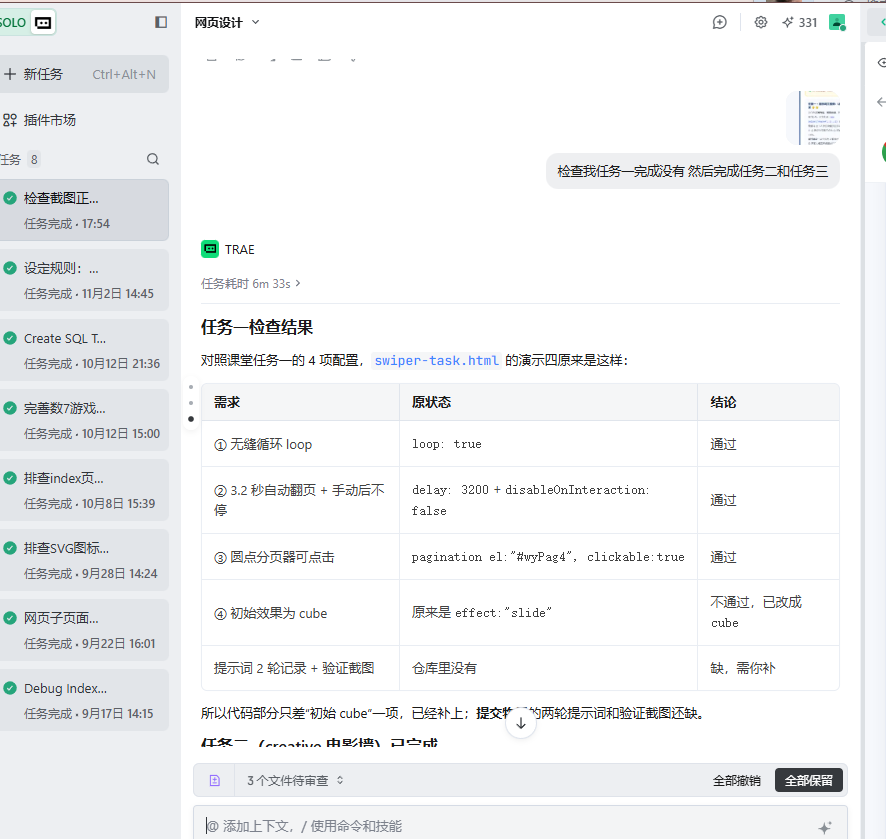

# 提示词记录

---

## 记录 1

- **时间**: 2026-10-22 13:42:15
- **模型**: Trae (proprietary model from Trae team)
- **提示词内容**:

设定规则：从现在开始，所有CSS类名，id名、js变量都以wy_开始，所有的提示词都在执行之前写入文件gjy_prompt.md，以附加的方式写入，不覆盖之前的内容，写入的内容包括时间、使用的模型、提示词内容。

---

## 记录 2

- **时间**: 2026-10-22 13:42:15（会话内，接续上一条规则）
- **模型**: Trae (proprietary model from Trae team)
- **提示词内容**:

设置规则：新建的html文件加入超链接到首页index.html

---

## 记录 3

- **时间**: 2026-10-22 13:50:00
- **模型**: Trae (proprietary model from Trae team)
- **提示词内容**:

做两个html网页iconfont-1.html,inconfont-2.html，分别显示font awesome图标和lucide图标，前者使用字体图标的方式，后者使用svg的方式，相关的cdn文件下载到本目录下的cdn目录。

---

## 记录 4

- **时间**: 2026-10-22 14:20:00
- **模型**: Trae (proprietary model from Trae team)
- **提示词内容**:

请根据skills下面的frontend-design里面的skill去优化iconfont-1.html和iconfont-2.html两个页面的设计等个，使其更有艺术美感，更优雅。

---

## 记录 6

- **时间**: 2026-10-26 14:30:00
- **模型**: Trae (proprietary model from Trae team)
- **提示词内容**:

先完成level1，数据是data.js

---

## 记录 7

- **时间**: 2026-10-29 14:30:00
- **模型**: Trae (proprietary model from Trae team)
- **提示词内容**:

接着完成level2

---

## 记录 5

- **时间**: 2026-10-22 14:55:00
- **模型**: Trae (proprietary model from Trae team)
- **提示词内容**:

根据font目录中的iconfont图标完成移动端的固定的自适应宽度的下导航，导航项目包括4个，完成html网页的设计，网页名称iconfont-3.html和iconfont-4.html分别使用字体图标和svg，包括右上角的数字徽章和红点。

---

## 记录 8

- **时间**: 2026-10-29 20:23:00
- **模型**: Trae (proprietary model from Trae team)
- **提示词内容**:

`https://spontaneous-valkyrie-4e4229.netlify.app/target`这个是目标效果（对照 target 修正 starter-level2.html 差异，共修正 6 处：进度条取整、Top3 均分排序+学号后缀、statusTip 固定文案、failWarning 分后缀、detail 三行重写、refresh 筛选行为分离）。

---

## 记录 9

- **时间**: 2026-10-29 13:37:41
- **模型**: opencode / big-pickle
- **提示词内容**:

/init

---

## 记录 10

- **时间**: 2026-10-29 14:25:00
- **模型**: Trae (proprietary model from Trae team)
- **提示词内容**:

创建 git-push-project skill：初始化仓库、git init、配置 remote origin=https://github.com/goujinyuan/goujinyuan0819.git、首次 commit 63 文件、创建 ED25519 SSH 密钥（但 SSH port 22 被防火墙阻断，改用 HTTPS）、SKILL.md 写入 c:\Code\网页设计\.trae\skills\git-push-project\

---

## 记录 11

- **时间**: 2026-11-02
- **模型**: Trae (proprietary model from Trae team)
- **提示词内容**:

修改规则 AGENTS.md，在新建 HTML 文件时要加入注释，尤其是 JS 部分代码函数的主要功能实现。注释内容包括：苟津源、建立时间、使用模型、功能名称及简介。

---

## 记录 12

- **时间**: 2026-11-02
- **模型**: Trae (proprietary model from Trae team)
- **提示词内容**:

AGENTS.md 全文翻译为简体中文；新增"文档语言约定"规则条：所有说明、检查条目统一简体中文，文件路径/HTML/CSS/JS 标识符/命令保留英文。后续生成文档、检查清单都遵守此约定。

---

## 记录 13

- **时间**: 2026-11-02
- **模型**: Trae (proprietary model from Trae team)
- **提示词内容**:

新建 tab-news.html：Tab 选项卡（国内新闻/省内新闻/国际新闻/最热新闻，国内默认），JS 单独放 js/tabs.js 外部引用，可复用。实现：事件监听 + 清除全部选中状态 + 设置当前选中状态。必须遵循新规则：文件头注释、JSDoc、wy_ 前缀、返回首页链接。

---

## 记录 14

- **时间**: 2026-11-02
- **模型**: Trae (proprietary model from Trae team)
- **提示词内容**:

用户上传参考图（汽车上市 Tab：最新上市/即将上市 + 下方表格），要求 tab-news.html 样式照此参考图实现，完成后 commit + push 到 GitHub goujinyuan0819 仓库。

---

## 记录 15

- **时间**: 2026-11-02
- **模型**: Trae (proprietary model from Trae team)
- **提示词内容**:

tab-news.html 1:1 复原参考图视觉：Tab 短蓝色高亮线（居中、约50%宽、2px）、浅灰表头背景、表格行浅灰分隔线、容器圆角阴影。业务数据仍是 4 个新闻 tab（国内/省内/国际/最热）。

---

## 记录 16

- **时间**: 2026-11-02
- **模型**: Trae (proprietary model from Trae team)
- **提示词内容**:

参考图是汽车上市信息表（最新上市/即将上市、上市时间/品牌车型/售价万元、沃尔沃S60L/牧马人龙腾典藏/高尔夫7等），之前只还原了视觉样式，数据错搞成新闻了。改回参考图的汽车上市业务数据。

---

## 记录 17

- **时间**: 2026-11-02
- **模型**: Trae (proprietary model from Trae team)
- **提示词内容**:

新规则：CSS/JS 前缀从 wy_ 改为 gjy_（苟津源首字母）；GitHub 仓库名必须包含姓名全拼 goujinyuan（已满足 goujinyuan0819）；完成后 GitHub Pages 发布。

---

## 记录 18

- **时间**: 2026-11-03 22:13:43
- **模型**: Trae (proprietary model from Trae team)
- **提示词内容**:

帮我看一下我11下面的截图对吗（上传 24001010819-苟津源-三级项目报告.doc，核对第 11 条“观察 ARP/DNS/TCP/HTTP 报文”下面的截图内容）

---

## 记录 19

- **时间**: 2026-11-03 22:17:17
- **模型**: Trae (proprietary model from Trae team)
- **提示词内容**:

我后面的图片分别应该是什么样子的 你能告诉我吗（接上一条，说明第 11 条之后 ARP 应答、DNS、TCP 三次握手、HTTP 各截图应包含的字段与正确取值）

---

## 记录 20

- **时间**: 2026-11-08 17:54:06
- **模型**: Trae (proprietary model from Trae team)
- **提示词内容**:

检查我任务一完成没有 然后完成任务二和任务三（任务一：演示四 loop/3.2s 自动播放不中断/圆点可点/初始 cube；任务二：演示四新增第 7 个 creative 电影墙按钮并写下 prev/next 作用；任务三：光影展新增第六件展品爱达·魔都号（AI 生成 16:9 图）+ 一个课堂未讲的 Swiper 能力）

---

## 记录 21

- **时间**: 2026-11-08 17:57:54
- **模型**: Trae (proprietary model from Trae team)
- **提示词内容**:

我截图放在哪2（询问课堂任务验证截图应该存放在项目中的哪个目录）